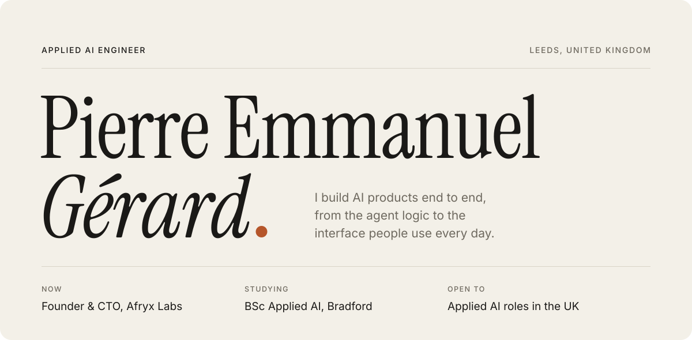

 

I'm Pierre, an applied AI engineer and the founder & CTO of [Afryx Labs](https://www.afryxlabs.com). Most of my work sits where models meet real users: agent workflows, evaluation, and the product around them. I'm in my final year of a BSc in Applied AI at the University of Bradford.

 

### What I'm working on

**[Kampus](https://www.kampusafryx.com)** 
A school management platform covering admissions, academics, finance and communication, with an AI operations layer. Live with fee-paying schools. Co-developed by Afryx Labs. 
Next.js · Supabase · Expo · LangGraph

**SiteDue** 
A billing-completion web app for UK commercial electrical maintenance businesses, so finished jobs actually get invoiced. I lead product and architecture for a five-person team. 
React · Vite · Supabase

**[MenoClinic](https://menoclinic.uk)** 
A clinician-led AI triage prototype for a UK menopause clinic. It turns pre-consultation questionnaires into structured summaries and highlights red flags and missing information. The clinician makes every decision, and the system is tested on synthetic cases the clinician has approved. 
Human-in-the-loop · Evaluation · Synthetic data

**[pierre-agent-evals](https://github.com/ByEmG/pierre-agent-evals)** 
An evaluation harness for LLM agents. It sorts every failure into one of six categories and reports pass rate, cost and latency, so I can tell whether a change actually helped. 
Python · Anthropic API · pytest

 

### Tools I reach for

Python, TypeScript and SQL. The Claude API and LangGraph for agents. Next.js, React and React Native for product. Supabase, Postgres, Stripe and Vercel underneath.

 

### Get in touch

I'm open to applied AI engineering roles and internships in the UK.

[Email](mailto:ankouanepierre@gmail.com) &nbsp;·&nbsp; [Portfolio](https://pierreankouane.dev) &nbsp;·&nbsp; [LinkedIn](https://www.linkedin.com/in/pierreemmanuelgerard) &nbsp;·&nbsp; [Afryx Labs](https://www.afryxlabs.com)

 

Fewer things, done properly.
