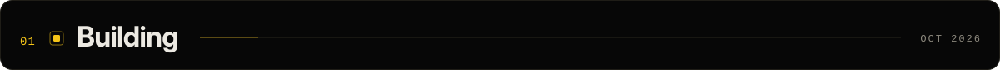
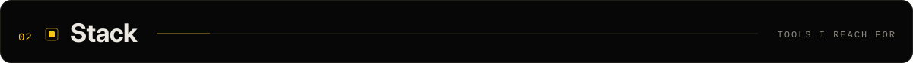
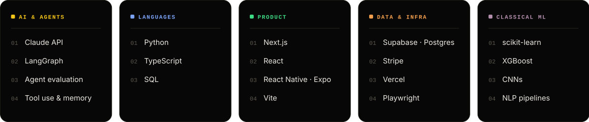

 

 

I work at the **applied layer of AI**: agent orchestration, tool use, memory, evaluation, and the feedback loops that turn a model into a product. I take products from first sketch to production and stay close to both the architecture and the user.

Founder & CTO of **[Afryx Labs](https://www.afryxlabs.com)**, building world-class software from the continent, for the continent. Final-year BSc Applied AI at the University of Bradford.

 

 

&nbsp;

&nbsp;

&nbsp;

 

 

 

 

 

<b>Open to applied AI engineering roles and internships in the UK.</b> 
If you are building agents that need to work in the real world, I would like to hear about it.

 

&nbsp;
&nbsp;
&nbsp;
&nbsp;

  

&nbsp;

  

