 

I work at the **applied layer of AI**: agent orchestration, tool use, memory and evaluation, the parts that turn a model into a product. Founder & CTO of **[Afryx Labs](https://www.afryxlabs.com)**. Final-year BSc Applied AI at the University of Bradford.

 

&nbsp;

&nbsp;

 

 

<b>Open to applied AI engineering roles and internships in the UK.</b>

  

&nbsp;
&nbsp;
&nbsp;

  

