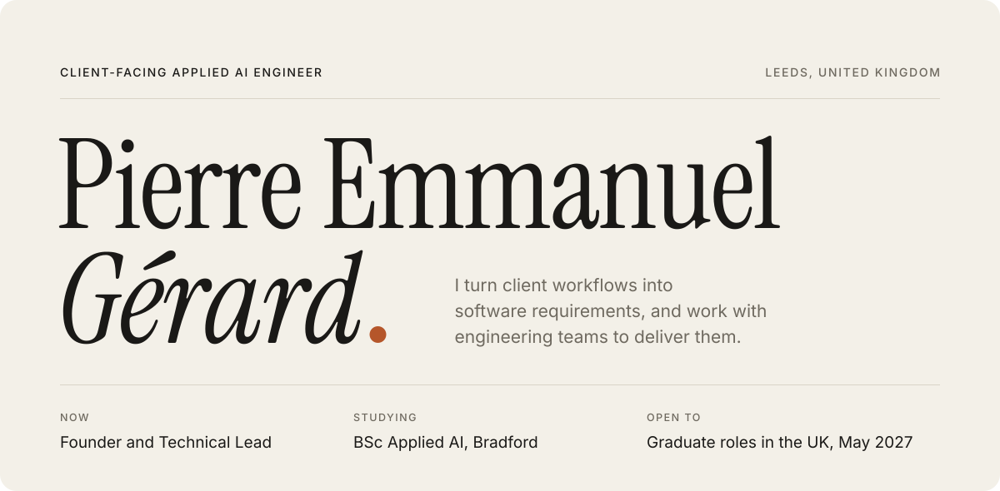

 

I'm Pierre, a client-facing applied AI engineer and the founder and technical lead of [Afryx Labs](https://www.afryxlabs.com). I turn client workflows into software requirements, design solutions, and work with engineering teams to deliver them. I'm in my final year of a BSc in Applied AI at the University of Bradford.

 

### What I'm working on

**[Kampus](https://www.kampusafryx.com)** 
One mobile-first platform combining school management and online learning for Fang Institute, built jointly by Afryx Labs and Kaeyros Analytics. I lead requirements and delivery for the engagement, with a target go-live in mid-February 2027. 
Next.js · Supabase · Expo · LangGraph

**SiteDue** 
A billing-completion web app for UK commercial electrical maintenance businesses, so finished jobs actually get invoiced. I lead product and architecture for a five-person team. 
React · Vite · Supabase

**[MenoClinic](https://menoclinic.uk)** 
A clinician-led AI triage prototype for a UK menopause clinic. It turns pre-consultation questionnaires into structured summaries and highlights red flags and missing information. The clinician makes every decision, and the system is tested on synthetic cases the clinician has approved. 
Human-in-the-loop · Evaluation · Synthetic data

**[pierre-agent-evals](https://github.com/ByEmG/pierre-agent-evals)** 
An evaluation harness for LLM agents. It sorts every failure into one of six categories and reports pass rate, cost and latency. In an initial eight-case experiment, cutting the step budget from 10 to 3 took passes from 8/8 to 5/8, and every failed run stopped too early. 
Python · Anthropic API · pytest

 

### Tools I reach for

Python, TypeScript and SQL. The Claude API and LangGraph for agents. Next.js, React and React Native for product. Supabase, Postgres, Stripe and Vercel underneath.

 

### Get in touch

I'm looking for UK graduate Solutions Engineer and Implementation Engineer roles from May 2027.

[Email](mailto:ankouanepierre@gmail.com) &nbsp;·&nbsp; [Portfolio](https://pierreankouane.dev) &nbsp;·&nbsp; [LinkedIn](https://www.linkedin.com/in/pierreemmanuelgerard) &nbsp;·&nbsp; [Afryx Labs](https://www.afryxlabs.com)

 

Fewer things, done properly.
